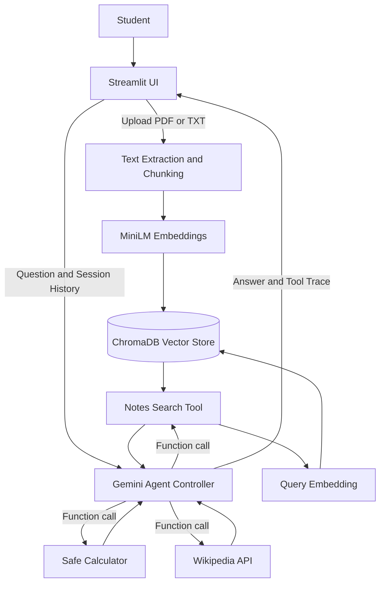

# AI StudyMate Pro — System Architecture

1. User enters a question or uploads PDF/TXT through Streamlit.
2. Upload pipeline extracts text, creates overlapping chunks, computes MiniLM embeddings, and indexes chunks in a ChromaDB collection.
3. Agent receives the current user request and recent session chat history.
4. Gemini chooses whether to call `search_notes`, `calculator`, or `wikipedia_search`.
5. Python executes the selected tool safely and returns a structured result to Gemini.
6. Gemini may call more tools, then generates the final answer.
7. Streamlit shows the answer, execution trace, and session history.

